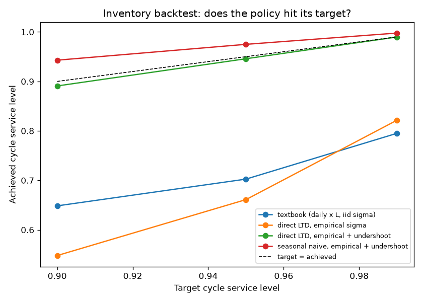

# Demand Forecasting & Inventory Optimization

Forecasts daily sales for each store-item, then converts those forecasts into
operations-research inventory decisions (safety stock, reorder point, EOQ,
newsvendor) for 500 store-item combinations.

Dataset: [Store Item Demand Forecasting Challenge](https://www.kaggle.com/c/demand-forecasting-kernels-only)
(10 stores x 50 items x 5 years of daily sales, ~913,000 rows)

## Pipeline

```
data  ->  features  ->  forecast  ->  inventory policy  ->  dashboard
```

## Project structure

```
demand-forecast-inventory/
├── data/raw/            # put Kaggle train.csv here (auto-falls back to synthetic)
├── notebooks/01_eda.py  # Step 2: EDA (seasonal decomposition, ADF test)
├── src/
│   ├── data.py          # Step 1: load real data or generate synthetic
│   ├── features.py      # Step 3: calendar / lag / rolling features
│   ├── models.py        # Step 4: baseline + linear regression, metrics
│   ├── inventory.py     # Step 5: safety stock / ROP / EOQ / newsvendor
│   └── backtest.py      # Step 7: day-by-day (s, Q) policy replay on 2017 Q4
├── agent/
│   ├── agent.py         # CLI Claude agent (tool use)
│   ├── tools.py         # pipeline functions exposed as tools
│   └── mcp_server.py    # same tools + backtest, as an MCP server
├── app.py               # Step 6: Streamlit dashboard
└── requirements.txt
```

## Quick start

```bash
pip3 install -r requirements.txt

python3 notebooks/01_eda.py   # exploratory analysis -> figures in outputs/
python3 src/models.py         # forecast: compare baseline vs linear regression
python3 src/inventory.py      # 500-row inventory policy table
python3 src/backtest.py       # replay Q4 2017: target vs achieved service level
streamlit run app.py          # interactive dashboard
```

Works on synthetic data out of the box. For real data, drop the Kaggle
`train.csv` into `data/raw/` and rerun — `load_sales()` switches automatically.

## Key results (real Kaggle data)

Time-based split at 2017-10-01; test = last 3 months of 2017
(46,000 rows across 500 store-item series).

| Model | MAE | RMSE | SMAPE |
|-------|-------|--------|-------|
| Seasonal Naive (baseline) | 9.076 | 12.051 | 18.56 |
| Linear Regression | 6.996 | 9.167 | 14.82 |

Linear regression beats the seasonal-naive baseline by ~23% on MAE
(6.996 vs 9.076).

> Numbers above are on the real Kaggle `train.csv`. 
> pipeline falls back to synthetic data, which gives different results.

## Inventory backtest: does the policy deliver what it promises?

A safety-stock formula *promises* a service level. `src/backtest.py` checks the
promise: it replays 2017 Q4 day by day for all 500 store-items, runs a
continuous-review (s, Q) policy against the **actual** sales (lost-sales), and
measures the cycle service level (share of orders with no stockout while in
transit) it really achieved.

To keep it honest, sigma, EOQ and undershoot are estimated on a **validation**
window (2017 Q3), models are trained before that, and every reorder point only
uses information available on that day.



Pooled over ~1,750 order cycles (real Kaggle data):

| Policy | Target 90% | Target 95% | Target 99% |
|--------|:---:|:---:|:---:|
| Textbook: `L x daily forecast + z * sigma_1 * sqrt(L)` | 64.8% | 70.3% | 79.5% |
| Direct lead-time-demand model, empirical sigma_L | 54.8% | 66.1% | 82.2% |
| **Direct LTD, empirical sigma_L + undershoot correction** | **89.1%** | **94.6%** | **99.0%** |
| Seasonal naive LTD, empirical sigma_L + undershoot | 94.3% | 97.5% | 99.8% |

**What this shows**

- **The textbook policy misses its target badly**: it promises 95% and delivers
  70%.
- **The main cause is undershoot, not forecast error.** The ROP formula assumes
  you reorder *exactly* at s. With ~50 units of demand per day, the inventory
  position usually jumps past s, so each order starts with less cover than
  planned. Renewal theory gives the fix (`inventory.reorder_point_with_undershoot`):
  `s = LTD + E[U] + z * sqrt(sigma_L^2 + Var[U])`, with
  `E[U] = E[D^2] / 2E[D]` and `Var[U] = E[D^3] / 3E[D] - E[U]^2`.
  A Monte-Carlo unit test confirms the fix hits the target with known demand.
- **With that correction, the policy is calibrated**: 89.1 / 94.6 / 99.0%
  against targets of 90 / 95 / 99%.
- **Seasonal naive *over*-delivers**: its validation-window sigma is larger than
  the Q4 errors, so it carries more stock than needed (363k vs 359k units on hand
  at the 95% target). Being calibrated is what matters here: when you promise
  95%, you should get 95%, not 70% or 97.5%.

Limitations: one test quarter only; normal-approximation quantiles; costs are
illustrative; per-series results are noisy (3-4 order cycles each).

## MCP server (use the pipeline from any agent)

`agent/mcp_server.py` exposes the tools below over the
[Model Context Protocol](https://modelcontextprotocol.io), so Claude Code, Claude
Desktop, Cursor and other MCP clients can call the pipeline directly:

| Tool | What it does |
|------|--------------|
| `get_forecast` | Forecasted avg daily demand + error std |
| `get_inventory_policy` | Safety stock / ROP / EOQ / newsvendor at a service level |
| `check_stockout_risk` | P(demand > stock) over a horizon |
| `run_inventory_backtest` | Target vs achieved service level per policy for one store-item |

Every response includes a `provenance` block (data source, train/validation/test
windows, assumptions), so the agent can say where a number came from and what it
assumes. All tools are marked read-only.

```bash
pip install -r requirements.txt
claude mcp add demand-forecast -- python3 /absolute/path/to/agent/mcp_server.py
```

Then ask: *"For store 2 item 10, does a 95% service-level policy actually hit
95%? Compare the policies."*

## AI Agent (natural-language interface)

An LLM agent (Claude, via tool use/function calling) that operates the
forecasting pipeline through conversation. The model decides which tool to
call and with what arguments — it is not a fixed script.

Three tools wrap the pipeline's real functions:

| Tool | What it does |
|------|--------------|
| `get_forecast` | Forecasted average daily demand + error std for a store-item |
| `get_inventory_policy` | Safety stock / reorder point / EOQ / newsvendor qty at a chosen service level |
| `check_stockout_risk` | Probability that demand exceeds current stock over a horizon |

The model is trained once at startup and held in memory, so tools answer
instantly. Example session:

you > Store 2, item 10 has 200 units left. What's the stockout risk this week?
[tool] check_stockout_risk({'store': 2, 'item': 10, 'current_stock': 200, 'days': 7})
agent > High alert — Store 2, Item 10 is at serious risk of stocking out this week.
Expected demand (7 days): ~699 units. Current stock: 200 units.
Stockout probability: ~100%. You're covering about 2 days of demand —
Reorder immediately.

Run it:

```bash
pip install -r requirements.txt
export ANTHROPIC_API_KEY=sk-ant-...
python3 agent/agent.py
```

## Notes/design decisions
- Time-based train/test split (never random — that leaks the future).
- Lag/rolling features computed within each (store, item) group.
- Rolling features shifted by 1 to exclude the current day (no leakage).
- Safety stock uses the std of forecast ERROR, so a better model directly
  lowers required inventory.
